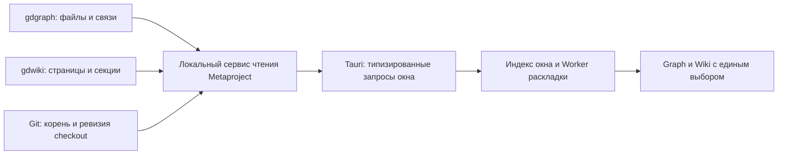

# Metaproject в Keryx Desktop

Исследование от 22 ноября 2026. База — `main` на `53cd6c9a2` (Desktop 0.2.11, CLI 0.4.48). В этом документе «узел» означает страницу wiki, модуль, файл или символ; компонент может быть отдельной wiki-страницей типа component либо группой кода с явной привязкой к файлам.

## Рекомендация

Добавить **Metaproject** рядом с Sessions, Flows, Pull requests и Issues. У вкладки один поиск и один выбранный объект для двух представлений, **Graph** и **Wiki**. При первом открытии показывать обзор модулей и доступных страниц. При выборе сущности показывать её ближайшие связи, а в панели справа — исходящий и входящий список со ссылками на доказательства. Полный граф проекта применяется для поиска и запросов, а на холст попадает ограниченная проекция.

Использовать **React + Cytoscape.js (Canvas)** для чтения ограниченного графа и **Web Worker** для расчёта координат, когда простого фиксированного расположения входящих и исходящих ветвей недостаточно. Для направленного режима сравнить лёгкую раскладку с **ELK layered в Worker**. Сохранить существующие источники `gdgraph` и `gdwiki`. Сделать передачу данных через небольшой версионированный контракт CLI и Tauri, используя локальный индекс окна для интерактивных действий. Графовая база и внешние сервисы не нужны для описанного объёма.

## Что есть в текущем Keryx

| Наблюдение | Следствие |
| --- | --- |
| Вкладки объявлены в `PROJECT_VIEWS`, содержимое монтируется из `App`, корень приходит из текущего окна проекта. В меню Project уже есть Wiki status, collect, index, validate, freshness, refresh и enrich. | Добавить пункт и заголовок через тот же список вкладок. Лениво монтировать просмотрщик. Для явной перестройки использовать существующий проектный раннер с выводом в терминальную панель. [Вкладки](../../apps/desktop/src/shell/AppShell.tsx#L16) · [Точки входа](../../apps/desktop/src/App.tsx#L555) · [Меню](../../apps/desktop/src/project/projectCommands.ts#L12) · [Раннер](../../apps/desktop/src/project/useProjectRunner.ts) |
| React 18, Vite и Tauri уже используются. В Desktop нет зависимости для графовой визуализации. Для Issues приложение вызывает фиксированные CLI-операции через зарегистрированный корень окна. Это удобный образец для read-only API. | Выделить своё семейство Tauri-команд и воспользоваться общим bounded runner. Для режима браузерной разработки добавлять контракт через существующий dev bridge с тем же набором действий. [Зависимости](../../apps/desktop/package.json) · [WebView-адаптер](../../apps/desktop/src/platform/issues.ts) · [Rust-граница](../../apps/desktop/src-tauri/src/issues.rs#L6) · [Dev bridge](../../apps/desktop/dev/bridge.ts) |
| `createGdgraphService` и `loadGraph` читают кодовые зависимости; типы уже включают отдельные слои символов, вызовов и wiki. `describes` хранит страницу, файл и происхождение связи. Обратный поиск page ↔ file уже есть. | Свести слои в модель просмотра поверх существующих данных. Формат файлового графа и потребители Shell/MCP сохраняют прежний контракт. [Сервис](../../src/gdgraph/service.ts) · [Загрузчик и обратные связи](../../src/gdgraph/query.ts#L16) · [Типы](../../src/gdgraph/types.ts#L60) |
| Связи page ↔ page можно получить из локальных Markdown-ссылок и wiki backlinks. Существуют секции wiki, идентификация страниц и локальный BM25. `wiki ask` включает также memory и правила жизненного цикла. | Переиспользовать сбор и ранжирование секций для чистого поиска по wiki. В UI показывать прямые Markdown-ссылки на страницы отдельно от `describes`. [Backlinks](../../src/wiki/backlinks.ts) · [Индекс секций](../../src/wiki/section-index.ts) · [Wiki ask](../../src/wiki/ask.ts#L75) |
| Текущий writer wiki-слоя сохраняет path-derived ID даже при наличии функции `wikiPageIdFor`, предпочитающей authored marker. `describes:N` выдаётся заново при сборке. | Для persistent navigation использовать индекс идентичности wiki и отображение текущего пути на ID. Страницы без маркера адресуются по пути; перемещение может сделать ссылку неразрешимой. Для рёбер использовать составной ключ вида «тип + source + target» в рамках снимка, сохраняя несколько доказательств. [Wiki layer](../../src/gdgraph/wiki-layer.ts#L34) · [Разрешение идентичности](../../src/wiki/section-index.ts#L116) |
| Файлы графа записываются последовательно. `loadGraph` читает оба базовых файла и присутствующие доп. слои, а отсутствие optional-слоя допускается. `checkGraphStaleness` уже сравнивает снимок с Git и рабочим деревом. | Перед ответом проверять наличие, полноту и поколение прочитанного снимка. Отдельно передавать свежесть графа и страниц. Совместимость со старым снимком должна давать чтение wiki и файлового графа даже при неизвестных связях. [Запись графа](../../src/gdgraph/build.ts#L896) · [Правила свежести](../../.metaproject/modules/gdgraph.md) · [Проверка staleness](../../src/gdgraph/staleness.ts#L261) |

Wiki и граф уже имеют разных владельцев. Wiki объясняет решения и поведение, кодовый граф фиксирует обнаруженные связи, SAC ссылается на них. Вкладка объединяет навигацию и сохраняет происхождение данных. [Архитектура Wiki, Graph, SAC](../../.metaproject/wiki/architecture/wiki-graph-sac.md)

## Замеры на рабочем checkout

В новом worktree `keryx gdgraph context` сообщил об отсутствии локального storage. Один `keryx gdgraph build` собрал данные с настройками этого проекта, включая слой символов. Счётчики ниже прочитаны из JSONL после сборки. `gdgraph build` вывел 4 541 файловый узел, а в `nodes.jsonl` также было 55 asset-узлов.

| Данные | Записей | Размер JSONL |
| --- | ---: | ---: |
| Файлы и assets | 4 596 | 0,58 МБ |
| Imports, assets и unresolved | 17 513 | 3,10 МБ |
| Wiki-страницы | 125 | 0,03 МБ |
| Страница описывает файл | 1 016 | 0,17 МБ |
| Символы | 35 098 | 9,02 МБ |
| Вызовы, определения и неразрешённые вызовы | 223 716 | 48,37 МБ |

119 страниц имеют хотя бы один разрешённый `describes`, шесть — `undecidable`. Происхождение рёбер: 165 frontmatter, 267 Related Code, 584 key-files. Пример плотности для `src/wiki/service.ts`: 53 разных соседа по imports в обе стороны и 530 разных достижимых файлов в двух шагах. Для `apps/desktop/src/App.tsx` — 41 и 208. Это обосновывает выбор глубины 1 и ограничение второй волны даже после фильтрации по типу связи.

Замер wall time для установленного CLI 0.4.48 на этой машине: по пять запусков, прогретая файловая система, включён старт процесса, без Tauri IPC и отрисовки.

| Операция | Медиана | Диапазон |
| --- | ---: | ---: |
| `gdgraph find 'session registry'` | 656 мс | 633–716 мс |
| `gdgraph affected src/gdgraph/query.ts` | 540 мс | 531–569 мс |
| `wiki ask 'code graph'` | 372 мс | 372–401 мс |
| `wiki backlinks src/gdgraph/query.ts` | 451 мс | 449–459 мс |

Это замеры текущего CLI, а не сравнительный бенчмарк библиотек. Для индекса интерактивного поиска важен вывод: запуск CLI и чтение полного графа на каждый ввод или переход слишком дороги для предложенных ниже целей.

## Работа во вкладке

1. При открытии **Metaproject** видны поиск, фильтры типа и обзор модулей. Пункт **Wiki** показывает страницы по типам и статусу с тем же поиском. Сразу доступны каталог и последний пригодный граф; частичная недоступность одной стороны не блокирует другую.
2. Поиск совпадает по названию, пути, имени символа и тексту секций. Точный путь или имя попадает выше префикса, текстовые результаты показывают секцию и короткий фрагмент. Совпадения страниц, модулей, файлов и символов имеют явный тип. При выборе из списка панель и граф синхронизируются. Возврат назад восстанавливает выбор и камеру.
3. На графе выбранный узел закреплён, его входящие и исходящие рёбра выделены различно и подписаны в панели, остальное приглушено. Hover даёт временное выделение без стягивания камеры и загрузки. По клику узел становится центром. Доступны **Incoming / Outgoing / Both**, переключатель типа связи, один или два шага и кнопка «Показать ещё» с числом скрытых соседей. Дополнительный проход включать только явно.
4. Для страницы панель показывает Markdown, входящие wiki-ссылки, исходящие ссылки и Related code. Для файла — импорты, зависимые файлы, страницы, которые его описывают, и символы при наличии слоя. Для модуля агрегировать количество связей между файлами и дать раскрыть конкретные примеры. По ребру показать его тип, направление, обе стороны и источник. Неразрешённый импорт или вызов доступен как отдельная диагностика и не считается связью с разрешённым узлом.
5. Панель деталей разделяется перетаскиваемым и клавиатурным splitter как в Issues. В узком окне детали переходят в отдельный экран/панель с возвратом фокуса. Список соседей и результатов имеет все действия графа с клавиатуры. Canvas и цвет дополняют текст, а выделение дублируется контуром и подписями. При потере графического контекста список продолжает работать.

Образцы взаимодействия — локальный граф с регулируемой глубиной и подсветкой при наведении у Obsidian, проверяемый переход к определению и списку ссылок у Sourcegraph. Для Keryx эти идеи складываются в один граф с конкретными причинами связи. [Obsidian Graph view](https://obsidian.md/help/plugins/graph) · [Sourcegraph Code Navigation](https://sourcegraph.com/docs/code-navigation)

## Модель и транспорт

- **Read model.** Ввести `EntityRef` с типом `wiki | module | file | symbol` и идентификатором, привязанным к состоянию checkout. `Relation` — endpoint IDs, тип, направление, provenance, число исходных рёбер для агрегата. Источники: `imports` и opt-in `calls` из графа, `describes` и Markdown links, membership из текущего module map и уже известные определения из symbol layer. Символы с эвристическим сопоставлением отображать с соответствующей меткой. Компонент wiki является wiki-узлом, а исходный код компонента — файлом или символом с проверяемой привязкой. [Типы графа](../../src/gdgraph/types.ts) · [Модель wiki](../../src/wiki/types.ts)
- **Запросы.** Пример контракта: `summary()`, `catalog(kind, cursor)`, `search(query, filters, limit)`, `detail(ref)`, `neighborhood(ref, direction, edgeKinds, depth, limit)`. Ответ несёт `schemaVersion`, `snapshotId`, `availableLayers`, `builtAt`/ревизию, `freshness`, `complete` и ограничения. `detail` возвращает только выбранную страницу. `neighborhood` отдаёт и узлы для холста, и итоги для постраничного списка. Различать «у узла нет связей», «узел отсутствует в снимке» и «слой не построен».
- **IPC и индексация.** Начать с короткого CLI-запроса для status и пакетного чтения минимального каталога с отношениями модулей. Собрать индекс названий, путей и adjacency один раз на `snapshotId`. Выполнять поиск по каталогу и подсветку текущего набора локально. Для полнотекстового поиска и раскрытия ещё не загруженного слоя использовать общий CLI-сервис. Измерить холодный старт и тёплый набор: если затраты на запуск процессов остаются в интерактивном пути, перейти к отдельному долгоживущему проектному reader с NDJSON и одним индексом на окно/checkout. Нужны timeout, cancellation, backpressure и ограничение объёма ответа. Для небольших ответов достаточно Tauri `invoke`; Channel подходит для порций и прогресса. Просмотр живёт независимо от запущенной модельной сессии. [Tauri Commands и Channels](https://v2.tauri.app/develop/calling-rust/)
- **Согласованность.** Core читает все слои из одного поколения. Предпочтительно публиковать build-манифест атомарно последним, с идентичностью набора и проверяемыми путями или хранить поколения за атомарным указателем. Пока новый writer отсутствует, reader проверяет набор файлов до/после чтения и возвращает предыдущий пригодный снимок при изменениях. В старом формате такая проверка обнаруживает гонку чтения, но не доказывает, что оборвавшаяся запись оставила все слои одного поколения. Состояние явно показывать как `unknown` или `partial`, а не как свежий снимок. Проект, checkout и запрос имеют свой ключ/поколение, чтобы отложенный ответ окна A не попал в B.
- **Проекты и данные.** Корень берётся из зарегистрированного окна Tauri, запросы используют разрешённые идентификаторы и ограниченные относительные пути. В заголовке видны checkout и свежесть. Данные wiki, полученные через поддерживаемый reference, должны иметь явное происхождение; граф всегда указывает checkout, по которому построен. Прочтение refs из соседних проектов подчиняется явным разрешённым ссылкам и пользовательскому выбору, а совпадения названий не связывают репозитории. Симлинки, вложенные проекты и смену рабочего каталога проверять после канонизации. В wiki переиспользовать санитайзер репозиторного Markdown и отдельно разрешать внутренние ссылки и локальные медиа. Внешние ссылки открывать по клику; внешним изображениям не позволять отправлять сетевые запросы при чтении офлайн. [Рендерер Markdown](../../apps/desktop/src/components/Markdown.tsx)
- **Обновление.** Отсутствующая wiki предлагает Init или существующий Project menu. Отсутствующий graph предлагает **Build graph**, при устаревшем остаётся доступен последний снимок, видна причина и действие **Rebuild graph**. Чтение wiki без графа поддерживается. Любая пересборка использует существующую команду и показывает прогресс; открытие вкладки само индексирует уже построенный снимок, а сборку проекта запускает пользователь.

## Выбор библиотек

| Вариант | Плюсы для задачи | Ограничения и решение |
| --- | --- | --- |
| Cytoscape.js Canvas | Направленные рёбра, классы выделения, события и графовые коллекции под единый вид. Достаточно для выбранного подграфа. | **Первый кандидат.** Обновлять классы пачкой, отключить постоянные edge labels и тяжёлые стили. Измерить на WKWebView и Retina. [Cytoscape.js](https://js.cytoscape.org/#performance) |
| Sigma.js + Graphology | WebGL-рендеринг, быстрый pan/zoom для больших наборов, стилевые обновления и события. | Кандидат для более плотного обзора, если Canvas не выдержит бюджет после агрегации. Отдельно проверить потерю контекста, память и режим нескольких окон. [Sigma rendering](https://www.sigmajs.org/docs/advanced/layers/) · [Lifecycle](https://www.sigmajs.org/concepts/lifecycle/) |
| React Flow | Собственные React-узлы с кнопками и контролями, пригоден для небольшой редактируемой схемы. | Подходит для будущего сценария редактирования диаграмм. Для исследовательского просмотра большого количества простых узлов добавляет стоимость обновления React и DOM. Такой сценарий требует собственной оптимизации подписок и видимости. [React Flow Performance](https://reactflow.dev/learn/advanced-use/performance) |
| ELK.js | Направленная layered-раскладка подходит для import/use и разнесения входящих и исходящих ветвей. Поддерживает Worker. | Подключать лениво для подграфов по необходимости и кешировать позиции. При необходимости разворачивать рёбра внутри алгоритма раскладки. Стрелки в UI сохраняют направление исходных зависимостей. [ELK.js](https://github.com/kieler/elkjs) |

Для поиска переиспользовать `findNodes`/`findSymbols` и `buildSectionIndex`/`rankSections`, затем проверить ранжирование на путях, PascalCase, дубликатах имён, опечатках и кириллице. Префиксный индекс и типовые фасеты можно добавить поверх этих функций. SQLite FTS5 имеет смысл как производный дисковый кеш, только если размер каталогов и время построения индекса покажут необходимость. [find](../../src/gdgraph/find.ts#L454) · [Section index](../../src/wiki/section-index.ts#L453) · [SQLite FTS5](https://www.sqlite.org/fts5.html)

## Прототип и приёмка

| Шаг | Результат |
| --- | --- |
| 1. Протокол и выборка | На реальном снимке Keryx и большом репозитории измерить объём ответа, чтение одной страницы; проверить поколения, отсутствующий `describes`, выключенные символы и неизвестную актуальность. Простой каталог и списки должны работать независимо от графической библиотеки. |
| 2. Один полный путь | Нативный пользователь находит wiki-страницу, открывает Markdown, выбирает Related code, видит рёбра, переходит на зависимый файл и обратно к документирующей странице. Тот же путь проходит с клавиатуры. |
| 3. Сравнение рендереров | Подставить один и тот же проецируемый dataset в Cytoscape и Sigma. Прогнать открытие, выбор, pan/zoom, два шага от `src/wiki/service.ts`, потерю графического контекста и два окна. Записать P50/P95 времени кадра, latency поиска и выбора, memory delta по процессам и размер lazy chunk. Прогнать в нативном Keryx macOS/WKWebView, на Apple Silicon и по возможности Intel. Browser preview нужен для отладки, измерения целевого WebView важнее. |
| 4. Рабочая поставка | Добавить фильтры и пагинацию, стабильный выбор, перезапуск и смену проекта, отмену обслуживания старого окна, состояние пустых или устаревших слоёв. Закрепить проверки контракта в GitHub CI, навигацию и производительность проверить в Desktop. |

Начальные цели для прототипа, которые нужно измерить и при необходимости пересмотреть: P95 подсветки готовой окрестности ≤50 мс, тёплого поиска ≤150 мс, первый каталог на обычном Keryx checkout ≤1 с, 95% кадров при панорамировании ≤33 мс на целевом Mac. Начальный предохранитель холста — до 200 узлов и 400 рёбер, с пагинацией списка и доступом к остальным результатам. Подгружаемые символы и вызовы запрашиваются только для нужного контекста. Зафиксированные размеры и времена относятся к CLI. Производительность рендеринга, раскладки и IPC предстоит измерить в нативном прототипе.

Маршрутизация исследования: `graph_used: yes · wiki_used: yes · ctx_used: yes · raw_rg_used: no`.
