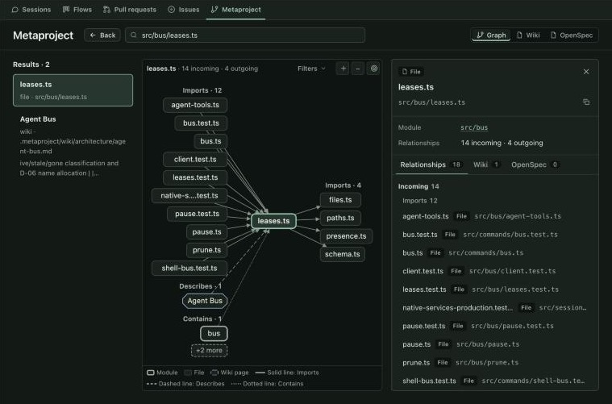

# Explore project knowledge in Keryx Desktop

Open **Metaproject** in a project window, or press **⌘5**. Use **Graph** to
trace relationships between project objects and **Wiki** to read articles.
Each view remembers its own search and selection. **Back** restores the
previous view, including the search and scroll position. The explorer
reads the open checkout locally and works without a GitHub account or a model
provider.

## Browse OpenSpec

Select **OpenSpec** to browse **Specs**, **Changes** and **Archive** from the
open checkout. Requirements and scenarios show their source; archived changes
provide historical context. Select **Archive** to search historical changes.
**Open current spec** opens the linked specification directly. Use **View in
Graph** when you want to explore its relationships. Missing or partial
OpenSpec data does not prevent using Graph and Wiki.

The same checkout-local reader is available in a terminal or Keryx Shell:

```bash
keryx openspec list --kind spec --json
keryx openspec search "review" --scope all --json
keryx openspec show openspec/specs/review/spec.md --json
```

## Set up the project

1. Install [Keryx Desktop and its matching CLI](../desktop-app.md#install).
   In Desktop, use **Open Folder…** to open the repository or worktree you
   want to explore.
2. If the repository already has a `.metaproject/`, use that workspace.
   Otherwise, initialize it from the repository root.

   ```bash
   keryx init --yes
   ```

3. Open **Metaproject** and select **Rebuild graph** when the view reports
   **Graph missing** or **Graph stale**. The terminal panel shows the build
   progress. You can also build it from the same checkout in a terminal.

   ```bash
   keryx gdgraph build
   ```

4. If the wiki is empty, create pages for the components and architecture the
   team wants to document. To start with graph-derived component drafts,
   run `keryx wiki collect --limit 10`. To write a page by hand, scaffold it
   with `keryx wiki new` and edit the resulting Markdown under
   `.metaproject/wiki/`.

   ```bash
   keryx wiki new architecture event-delivery --title "Event delivery"
   keryx wiki index
   keryx wiki validate
   ```

   Reopen **Metaproject** to see new pages. Rebuild the graph after changing
   which code a page covers so the `describes` relationships reflect the
   change. Review generated drafts before relying on their prose. See the
   [wiki module](../modules.md#gdwiki) for page types and lifecycle.

### Enable symbol and call relationships

Files, modules, wiki pages and import relationships work with the file
graph. For symbol search and the **defines** and **calls** filters, enable the
optional symbol layer per checkout and rebuild it.

```bash
keryx gdgraph symbols enable
keryx gdgraph build
keryx gdgraph symbols status
```

See the [symbol-layer setup](../complete-setup-and-agent-workflows.md#8-configure-the-optional-symbol-layer)
for the pinned grammar assets used by supported languages.

## Find a page, file, module or symbol

Type a name, path, or phrase from a wiki page into **Search names, paths and
wiki text**. Use a repository-relative path such as `src/wiki/service.ts`
when several files share a name. Wiki body matches show a snippet so you can
see why a page matched. For example, searching for `inode-aware cursor` in
the Keryx repository finds the **Agent Bus** page.

Select a result to inspect it. The graph highlights the selected item and
shows the nodes related to it by the current filters. In **Wiki**, a page opens as a readable
article with its repository path. File and symbol results display their
identity and path. To inspect or edit their
source, open that path in your editor.

## Trace relationships in Graph



1. Select a starting item. Use **Direction → Outgoing** to follow its
   dependencies or links, and **Incoming** to see what points to it.
   **Both** includes each direction.
2. Start at **1 step** for direct neighbors. Use **2 steps** to follow those
   neighbors one level further. Turn off unrelated relationship types to
   narrow a busy graph.
3. Click a node to select it and open the details pane. Use its **Wiki** or
   **OpenSpec** tab to preview linked documents, then open the full document
   with the named action. Drag the divider, or focus it and use the arrow
   keys, to change the pane width. Press **Escape** to close it. You can also
   select a neighboring node with **Tab** and **Enter** in the relationship list.
   A relationship between two second-step items offers an **Open** button for
   each endpoint.
4. Read the relationship row for the exact path or source evidence when
   available. Check the arrow direction before following a dependency.

| Type | Direction |
| --- | --- |
| `imports` | A source file or module points to an imported file or module. |
| `asset` | A source file points to an asset it references. |
| `describes` | A wiki page points to code it covers. |
| `links` | A wiki page points to another page in the wiki. |
| `contains` | A module points to a file it contains. |
| `defines` | A file or symbol points to a symbol it defines. |
| `calls` | An indexed caller points to a resolved callee. |

For a dependency investigation, select the affected file, choose **Incoming**
and leave **imports** enabled. Start at one step and add the second step
when you need to see which modules use its direct consumers.

## Read and follow links in Wiki


Select **Wiki** in the view switcher to read the current page. Expand
**Relationships** below the article to follow related pages or files. The
article also supports links to headings and indexed items in the project.
HTTP and HTTPS links open in your browser.

Use **Graph** again to trace the same selection. To give an agent the same
context, use the path shown under the title in a session prompt. For example,
“Read `.metaproject/wiki/architecture/agent-bus.md` and trace the incoming
imports of `src/bus/leases.ts`.” The [agent context guide](give-an-agent-context.md)
covers how agents use the same wiki and graph data.

## Data, checkout boundaries and limits

| Layer | Source | How it changes |
| --- | --- | --- |
| Wiki | Markdown under `.metaproject/wiki/` | Edit the project pages or use the wiki CLI. |
| File and symbol graph | Generated gdgraph artifacts for the open checkout | Run **Rebuild graph** or `keryx gdgraph build`. |
| Selection and filters | The active Desktop view | Search, select a result, or change the view controls. |

Desktop sends read requests for catalog, search, detail, and neighbors through
the local Keryx CLI. It reads from the project folder associated with the
view. A Git worktree has its own graph freshness and may show a different
catalog from the main checkout. Desktop checks graph freshness when it loads
the catalog; search, detail and neighbor reads skip that check. Read requests
leave your files alone. **Rebuild graph** writes the generated graph artifacts.

The result list shows up to 200 items. A neighborhood is limited to 200 nodes,
400 edges, and two steps. Use a narrower search or filter when the view
reports a limit. The [gdgraph CLI](../cli-reference.md#gdgraph) also provides
`find`, `path` and `affected` for focused graph queries.

## Inspect the module from the CLI

Run the same read command the app uses from the open checkout to isolate a
graph or wiki problem from a rendering problem.

```bash
keryx metaproject-explorer --request '{"action":"search","query":"Agent Bus"}'
keryx metaproject-explorer --request '{"action":"detail","id":"wiki:architecture/agent-bus.md"}'
```

Copy the `node.id` from a search or catalog result when requesting detail or
neighbors. IDs identify a node in the current checkout. Each response carries
a `schemaVersion` and `snapshotId`. Desktop compares them before mixing
results from separate reads and asks to refresh if the underlying data changes.
The snapshot covers the graph, wiki and OpenSpec data. Graph freshness is not
part of it: creating or editing another file in the checkout can mark the
graph stale, and the results already loaded stay valid.

Before its first read, Desktop asks the selected CLI which read actions it
serves. Desktop accepts a CLI that lists every action it uses, so a CLI newer
than Desktop keeps working when it adds actions.

Desktop can calculate a file or wiki neighborhood from a complete catalog.
It asks the CLI for a neighborhood when the catalog is limited or the
selection or filters require symbol relationships. Modules represent
directories. A module-level import groups the imports between their files
and can carry example file pairs. See the
[CLI response contract](../cli-reference.md#metaproject-explorer).

## Recover from common problems

| What you see | What to do |
| --- | --- |
| **Graph missing** | Open existing wiki pages in **Wiki**, or select **Rebuild graph** to add code relationships. |
| **Graph stale** after switching branches or changing code | Rebuild from the open checkout. The stale graph can still show results from its last build. |
| **Graph unknown** or a layer fails to load | Rebuild and check the terminal output. For `defines` or `calls`, also check `keryx gdgraph symbols status`. |
| **Project knowledge changed while loading** | The graph was rebuilt, or a wiki page or OpenSpec file changed, between two reads. Select **Refresh catalog** to load a consistent snapshot. |
| **Search failed** | Select **Retry search** to repeat the current query. |
| The CLI does not support Metaproject Explorer | Choose the bundled CLI in **Settings → Desktop**, or update the CLI and Desktop together. |
| The selected CLI returned invalid Metaproject capabilities | The CLI lacks a read action this Desktop uses. Choose the bundled CLI in **Settings → Desktop**, or update the CLI. |
| A page has no **Relationships** section | Confirm the page links to other wiki pages or declares the code it covers, then rebuild the graph and check the filters in **Graph**. |

For maintenance of wiki references and freshness, see
[Keep the wiki current](keep-the-wiki-current.md).
