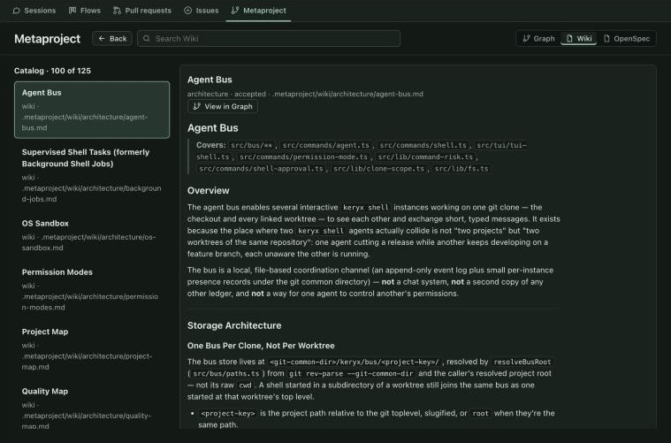

# Explore project knowledge in Keryx Desktop

Open **Metaproject** in a project window, or press **⌘5**. Use **Graph** to
trace relationships between project objects and **Wiki** to read articles.
Each view remembers its own search and selection. **Back** steps back through
the items you selected, not only through view switches, and restores the
search and scroll position of each step. If you leave the Metaproject tab and
return, the explorer keeps its view, search, selection and filters. The
explorer reads the open checkout locally and works without a GitHub account or
a model provider.

## Browse OpenSpec

Select **OpenSpec** to browse **Specs**, **Changes** and **Archive** from the
open checkout. Requirements and scenarios show their source; archived changes
provide historical context. Select **Archive** to search historical changes.
**Open current spec** opens the linked specification directly. Use **View in
Graph** when you want to explore its relationships. Missing or partial
OpenSpec data does not prevent using Graph and Wiki.

The same checkout-local reader is available in a terminal or Keryx Shell:

```bash
keryx openspec list --kind spec --json
keryx openspec search "review" --scope all --json
keryx openspec show openspec/specs/review/spec.md --json
```

## Set up the project

1. Install [Keryx Desktop and its matching CLI](../desktop-app.md#install).
   In Desktop, use **Open Folder…** to open the repository or worktree you
   want to explore.
2. If the repository already has a `.metaproject/`, use that workspace.
   Otherwise, initialize it from the repository root.

   ```bash
   keryx init --yes
   ```

3. Open **Metaproject** and select **Rebuild graph** when the banner reads
   **Graph is missing.** or **Graph is stale.** The banner is one line. Select
   **Details** beside it to read the reason. The terminal panel shows the
   build progress. You can also build it from the same checkout in a terminal.

   ```bash
   keryx gdgraph build
   ```

4. If the wiki is empty, create pages for the components and architecture the
   team wants to document. To start with graph-derived component drafts,
   run `keryx wiki collect --limit 10`. To write a page by hand, scaffold it
   with `keryx wiki new` and edit the resulting Markdown under
   `.metaproject/wiki/`.

   ```bash
   keryx wiki new architecture event-delivery --title "Event delivery"
   keryx wiki index
   keryx wiki validate
   ```

   Reopen **Metaproject** to see new pages. Rebuild the graph after changing
   which code a page covers so the `describes` relationships reflect the
   change. Review generated drafts before relying on their prose. See the
   [wiki module](../modules.md#gdwiki) for page types and lifecycle.

### Enable symbol and call relationships

Files, modules, wiki pages and import relationships work with the file
graph. For symbol search and the **Defines** and **Calls** relationship types,
which stay disabled in the Graph **Filters** popover until the symbol layer is
on, enable the optional symbol layer per checkout and rebuild it.

```bash
keryx gdgraph symbols enable
keryx gdgraph build
keryx gdgraph symbols status
```

See the [symbol-layer setup](../complete-setup-and-agent-workflows.md#8-configure-the-optional-symbol-layer)
for the pinned grammar assets used by supported languages.

## Find a page, file, module or symbol

Type a name, path, or phrase from a wiki page into **Search names, paths and
wiki text**. Use a repository-relative path such as `src/wiki/service.ts`
when several files share a name. Wiki body matches show a snippet so you can
see why a page matched. For example, searching for `inode-aware cursor` in
the Keryx repository finds the **Agent Bus** page.

The list header shows how many catalog items are shown out of the total, as
**Catalog · shown of total**. While you search it reads **Results** with
the number of matches instead.

Select a result to inspect it. In **Graph**, the selected item becomes the
center of the graph, with the nodes related to it by the current graph
filters around it. In **Wiki**, a page opens as a readable
article with its repository path. File and symbol results display their
identity and path. To inspect or edit their
source, open that path in your editor.

If the check of the selected CLI fails, the explorer shows the error with a
**Retry** button.

## Trace relationships in Graph


The graph shows a local neighborhood of the selected item in columns. What
points at the selected item is on its left, and what it points at is on its
right. In the picture, `src/bus/leases.ts` is selected: the files that import
it, the Agent Bus page that describes it and its module are on the left, and
the four files it imports are on the right. With **2 steps**, items one step
further out sit in additional columns beyond those, drawn fainter. The
header row above the graph shows its caption, the zoom controls and the
**Filters** button.

1. Select a starting item, such as `src/bus/leases.ts`. The graph shows
   what points to it and what it points at. Use **Filters** to follow only one
   direction.
2. Select **Filters** in the header row of the graph, next to the zoom
   controls. A popover opens with the graph visible behind it, and every change
   applies at once. Press **Escape** or click outside to close it.
   - **Direction**: **Outgoing** follows dependencies or links, **Incoming**
     shows what points to the item, and **Both** includes each direction.
   - **Depth**: start at **1 step** for direct neighbors. Use **2 steps** to
     follow those neighbors one level further.
   - **Relationship types**: turn off unrelated types to narrow a busy graph.
     They are named **Imports**, **Assets**, **Describes**, **Wiki links**,
     **Contains**, **Defines**, **Calls**, **Changes spec** and **Spec
     context**. **Defines** and **Calls** are disabled, with the reason
     shown, until the symbol layer is enabled.
   - **Reset filters** restores the defaults. While the filters differ from
     their defaults, the button reads **Filters · n** and is highlighted.
3. Read the groups. Each group of items has a caption with its relationship
   type and a count, for example **Imports · 7**. A column shows at most 12
   items. When a column has more, it keeps a few items from each
   relationship type and collapses the rest into a **+N more** entry. Click it
   to open the full list in the **Relationships** tab of the details panel.
4. Use the legend under the graph to read the shapes and lines. The shape and
   border of an item show its kind, such as module, file, symbol, Wiki page,
   spec or change. The line style shows the relationship family: solid,
   dashed or dotted, with the relationship types that use it. The legend lists
   only what the current graph contains. Meaning never depends on color alone.
5. Use the zoom in, zoom out and fit controls in the graph's header row to
   move around a large neighborhood. Click an item to select it. The graph re-centers on it,
   and while its relationships load the previous graph stays on screen,
   dimmed. **Back** returns to the item you selected before.
6. Read the details panel for the selected item. It shows the kind, the title
   and the path, with a **Copy path** control. Below are the facts: the
   module, the page type, the status and the relationship counts. Drag the
   divider, or focus it and use the arrow keys, to change the panel width.
   Press **Escape** to close it. Three tabs, each with a count, follow the
   facts:

   - **Relationships** is the default tab. It groups the relationships into
     **Incoming** and **Outgoing**, then by type. Click a row to select that
     item, or focus it with **Tab** and press **Enter**. The control at the end
     of a row opens the source evidence for that relationship, when there is
     any. For module imports it reads the count, such as **7 imports**;
     otherwise it reads **N examples**. Relationships between two second-step
     items sit in a **Second step** disclosure, closed until you open it. Each
     relationship offers an **Open** button for each endpoint. Check the direction before
     following a dependency.
   - **Wiki** previews the linked Wiki page. **Open in Wiki** opens the full
     page. When no page is linked, **Find a Wiki page** searches for one and
     **Draft Wiki page** starts a session that prepares a draft.
   - **OpenSpec** works the same way for specs and changes, with **Open in
     OpenSpec**, **Find an OpenSpec document** and **Draft OpenSpec change**.

| Type | Name in the app | Direction |
| --- | --- | --- |
| `imports` | Imports | A source file or module points to an imported file or module. |
| `asset` | Assets | A source file points to an asset it references. |
| `describes` | Describes | A wiki page points to code it covers. |
| `links` | Wiki links | A wiki page points to another page in the wiki. |
| `contains` | Contains | A module points to a file it contains. |
| `defines` | Defines | A file or symbol points to a symbol it defines. |
| `calls` | Calls | An indexed caller points to a resolved callee. |
| `changes-spec` | Changes spec | An OpenSpec change points to a spec it changes. |
| `spec-context` | Spec context | An OpenSpec document points to a spec or change that gives it context. |

For a dependency investigation, select the affected file, choose **Incoming**
and leave **Imports** enabled. Start at one step and add the second step
when you need to see which modules use its direct consumers.

## Read and follow links in Wiki



Select **Wiki** in the view switcher to read a page. Wiki keeps its own
search and selection, separate from Graph. Expand **Relationships** below the
article to follow related pages or files. This block always shows the direct
relationships of every type except **Defines** and **Calls**, and does not
follow the Graph filters. The
article also supports links to headings and indexed items in the project. A
link to a page or file that is not loaded yet is looked up and opened. If a
link cannot be resolved, the article says which path it could not find. HTTP
and HTTPS links open in your browser.

When a search from **Find a Wiki page** in the details panel has no match, the
Wiki says that no page matches and offers **Clear search**.

To trace a page in **Graph**, select it there or use **View in Graph**. To give an agent the same
context, use the path shown under the title in a session prompt. For example,
“Read `.metaproject/wiki/architecture/agent-bus.md` and trace the incoming
imports of `src/bus/leases.ts`.” The [agent context guide](give-an-agent-context.md)
covers how agents use the same wiki and graph data.

## Data, checkout boundaries and limits

| Layer | Source | How it changes |
| --- | --- | --- |
| Wiki | Markdown under `.metaproject/wiki/` | Edit the project pages or use the wiki CLI. |
| File and symbol graph | Generated gdgraph artifacts for the open checkout | Run **Rebuild graph** or `keryx gdgraph build`. |
| Selection and filters | The active Desktop view | Search, select a result, or change the view controls. |

Desktop sends read requests for catalog, search, detail, and neighbors through
the local Keryx CLI. It reads from the project folder associated with the
view. A Git worktree has its own graph freshness and may show a different
catalog from the main checkout. Read requests leave your files alone.
**Rebuild graph** writes the generated graph artifacts.

The result list shows up to 200 items. A neighborhood is limited to 200 nodes,
400 edges, and two steps. Use a narrower search or filter when the view
reports a limit. The [gdgraph CLI](../cli-reference.md#gdgraph) also provides
`find`, `path` and `affected` for focused graph queries.

## Inspect the module from the CLI

Run the same read command the app uses from the open checkout to isolate a
graph or wiki problem from a rendering problem.

```bash
keryx metaproject-explorer --request '{"action":"search","query":"Agent Bus"}'
keryx metaproject-explorer --request '{"action":"detail","id":"wiki:architecture/agent-bus.md"}'
```

Copy the `node.id` from a search or catalog result when requesting detail or
neighbors. IDs identify a node in the current checkout. Each response carries
a `schemaVersion` and `snapshotId`. Desktop compares them before mixing
results from separate reads and asks to refresh if the underlying data changes.

Desktop can calculate a file or wiki neighborhood from a complete catalog.
It asks the CLI for a neighborhood when the catalog is limited or the
selection or filters require symbol relationships. Modules represent
directories. A module-level import groups the imports between their files
and can carry example file pairs. See the
[CLI response contract](../cli-reference.md#metaproject-explorer).

## Recover from common problems

| What you see | What to do |
| --- | --- |
| **Graph missing** | Open existing wiki pages in **Wiki**, or select **Rebuild graph** to add code relationships. |
| **Graph stale** after switching branches or changing code | Rebuild from the open checkout. The stale graph can still show results from its last build. |
| **Graph unknown** or a layer fails to load | Rebuild and check the terminal output. For `defines` or `calls`, also check `keryx gdgraph symbols status`. |
| **Project knowledge changed while loading** | Select **Refresh catalog** to load a consistent snapshot. |
| **Search failed** | Select **Retry search** to repeat the current query. |
| The CLI does not support Metaproject Explorer | Choose the bundled CLI in **Settings → Desktop**, or update the CLI and Desktop together. |
| A page has no **Relationships** section | Confirm the page links to other wiki pages or declares the code it covers, then rebuild the graph and check the filters in **Graph**. |

For maintenance of wiki references and freshness, see
[Keep the wiki current](keep-the-wiki-current.md).
