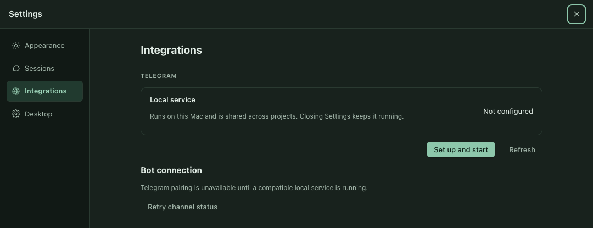
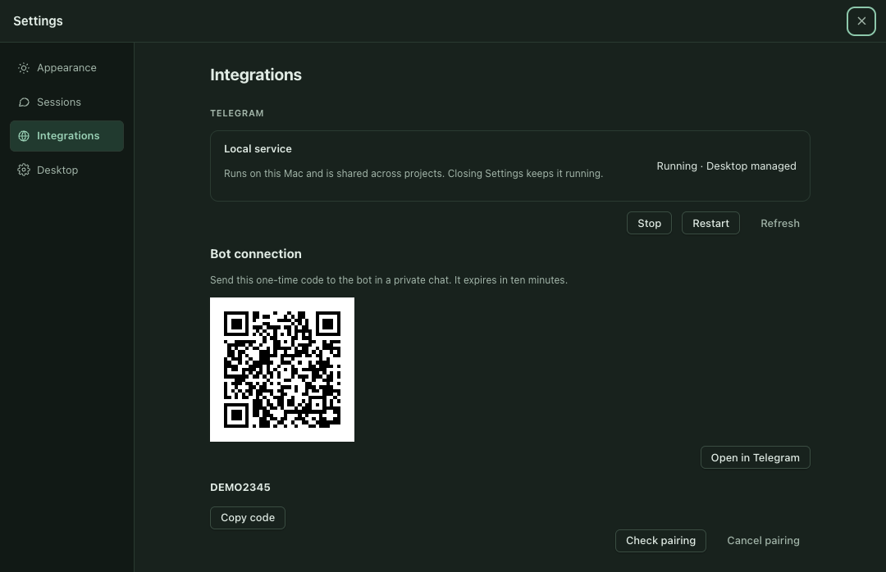
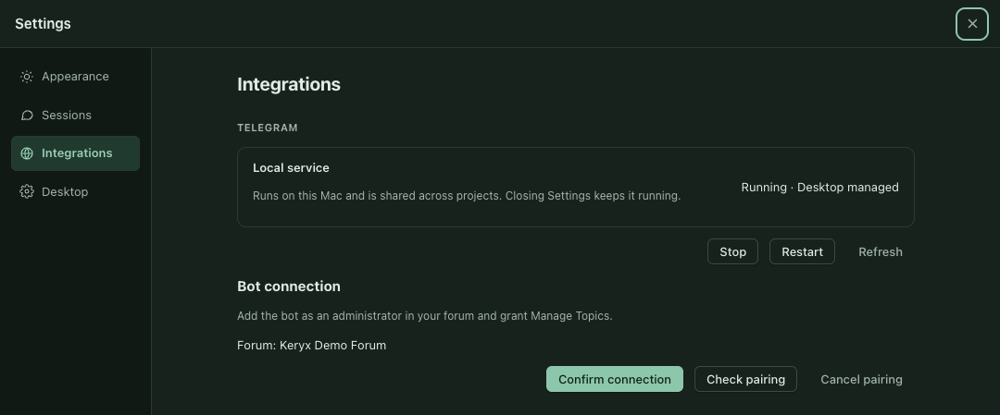
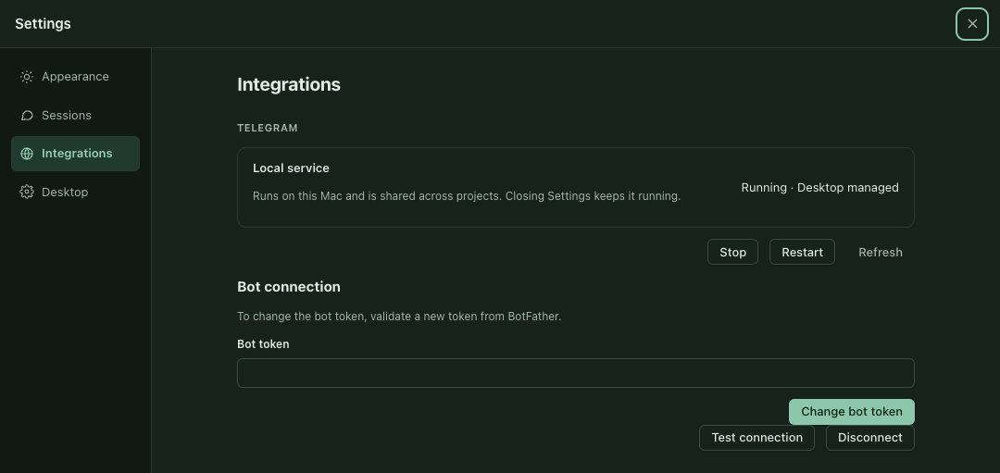
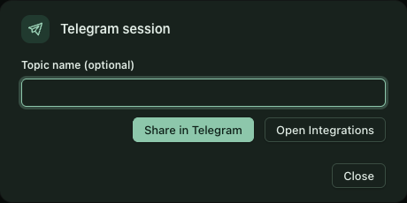
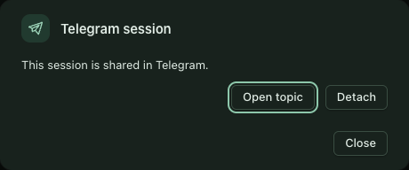

# Use Keryx Desktop from Telegram

Connect a bot once on your Mac, then share individual Desktop sessions with their own Telegram topics. A message from your phone and a message from Desktop use the same session, model and conversation. The Mac, the local `keryx serve` process and the Desktop session need to remain available while you work from Telegram.

This guide covers the **Desktop Telegram preview**. It requires a build with the Desktop Telegram capability and a compatible local CLI and service. With Keryx 0.4.50 and Desktop 0.2.13, launch Desktop with `KERYX_DESKTOP_TELEGRAM_PREVIEW=1`. When starting `keryx serve` yourself, use the same opt-in for that process. Desktop and the service must use the same local Keryx configuration profile. The screenshots show the Desktop UI in a browser with simulated native responses. The QR code and account and forum details are examples.

For example, to start a preview app bundle from a terminal on macOS:

```sh
KERYX_DESKTOP_TELEGRAM_PREVIEW=1 /Applications/Keryx.app/Contents/MacOS/keryx-desktop
```

Adjust the path if you installed Keryx Desktop in another location.

## 1. Start the local service

1. Open **Settings → Integrations → Telegram**.
2. Select **Set up and start** on a fresh setup, or **Start** if it is already configured. **Complete setup and start** adds the missing local API credential when the listener is configured but setup is incomplete.
3. Wait for **Running · Desktop managed**. If **Running · external** appears, Keryx has found a compatible listener started outside Desktop. Manage that listener from the process that started it.



The service is shared across projects in the same Keryx configuration profile. Closing Settings or changing projects keeps it running. **Stop** and **Restart** act on the Desktop-managed listener and preserve its configuration and bot pairing. They can interrupt attached sessions. Quitting Desktop closes its sessions and stops its managed listener. An external listener keeps running for other clients.

## 2. Pair your account and forum

1. Create a dedicated bot with [@BotFather](https://t.me/BotFather) and prepare a Telegram group with **Topics** enabled. Keryx creates session topics inside this forum group.
2. With the local service running, paste the token into the **Bot token** password field and select **Connect bot**. Use that field for the token. The QR code and manual pairing code identify the pairing attempt.
3. Scan the QR code with your phone or choose **Open in Telegram**. Tap **Start** in the private bot chat if Telegram prompts you. For the manual path, select **Copy code** and send the code to the bot in that private chat. The initial code is single-use and expires after ten minutes.
4. Back in Desktop, verify the displayed Telegram account ID and select **This is my account**.
5. Add the bot as an administrator in the forum with **Manage Topics** permission. Use the same Telegram account that claimed the code. If the bot is already an administrator and Keryx is still waiting for the group, send the one-time `/keryx_pair_forum` command displayed in Desktop in that forum from the confirmed account.
6. Verify the displayed forum and select **Confirm connection**. Once connected, select **Test connection** and look for the test message in **General**.







You can reopen Integrations to resume a pending pairing. **Check pairing** reloads its status. If the code expired or the account is wrong, select **Cancel pairing** and start again. When changing or storing a token, use the masked field and keep both the token and live pairing code out of screenshots and support messages. [Telegram bot creation and deep links](https://core.telegram.org/bots/features#botfather)

## 3. Share one Desktop session

1. Open the project in Keryx Desktop and go to **Sessions**. Open or create the session you want to share.
2. Click the paper-plane **Telegram session** icon in the session header. Give the topic a name or use the default, then select **Share in Telegram**.
3. Once the dialog says the session is shared, use **Open topic** or open the topic in the paired forum on your phone.
4. Send a short prompt such as `Reply with “Keryx is connected.”`. The Desktop transcript shows the message with **Via Telegram**. For a two-way check, send another prompt from Desktop and look for its final reply in the same topic.





You can attach several sessions in the same project. Each session gets a separate topic. Switching to another session or project keeps each attachment with its original session. Keryx does not copy previous turns into a new topic.

## 4. Work from either interface

| Action | Behavior |
| --- | --- |
| Send a text message in the topic | The paired account starts a turn in that session. Desktop shows its busy state and transcript. |
| Send another message while the session is busy | Telegram gets a busy reply. Wait for the current turn, then resend the message. |
| Send `/status` in the topic | Check whether the attached session is idle or working. |
| Send `/stop` in the topic | Request cancellation of that topic's current Telegram-origin turn. A turn started in Desktop stays under Desktop control. |
| Answer a question | Use Desktop for privileged, destructive, credential-related or other Desktop-only decisions. For a question with **Send to Telegram**, you can explicitly send the offered choices to the topic. The first valid answer settles the question. |
| Choose **Detach** in Desktop | Detach this session and close its topic for new work. Existing Telegram messages remain readable. To resume from Telegram, attach the session again. |

The integration sends final answers and limited progress messages. Tool inputs, tool results, internal reasoning and earlier history stay out of the mirrored stream. Keep the forum private and grant access to people who can read the session's replies. Telegram turns use Ask mode and remain subject to project policies and Desktop confirmations.

## 5. Change the bot or disconnect

| Action | What to expect |
| --- | --- |
| **Change bot token** for the same bot | Keryx checks the new token and the bot's forum rights. Confirm the replacement. A successful same-bot switch keeps the forum and existing session bindings. |
| **Change bot token** for a different bot | Pair the account and forum for the candidate bot. Confirm the switch. Old topics are retired. Reattach the sessions you want to share to create fresh topics. |
| **Disconnect → Disconnect bot** | Remove the machine-wide bot connection and attempt to delete its managed topics. Check the result for topics Telegram did not delete. |
| **Stop** or **Restart** under **Local service** | Change the service state while preserving the bot pairing. |

Keryx checks that Telegram accepts the new token's polling connection before activating it. After a failed change, refresh the status before retrying. If Keryx can recover the previous bot after revoking old bindings, the bot can become available again with fresh attachments.

## Troubleshooting

| What you see | What to check |
| --- | --- |
| **Telegram pairing is unavailable** | Start a compatible listener. In the preview, check that both Desktop's CLI and the service have the preview enabled and use the same profile. An older listener cannot provide the required capability. |
| **Unavailable** or an occupied port | Read the message under **Local service**. If the process is external, stop or restart it from its owning terminal. A second service using the same bot token can conflict with Telegram polling. |
| The pairing is waiting for the forum | Use the confirmed Telegram account, enable Topics in the group, and give the bot **Manage Topics**. If the bot is already an administrator, send the displayed command, including the bot username when shown, then choose **Check pairing**. |
| **Last connection attempt failed** | Read the reason under **Bot connection**. The local service keeps the latest activation failure after closing the pairing. The message clears after a successful activation or a service restart. |
| A revision conflict or uncertain outcome | Refresh the status first. Another Settings window or `/channels` may have changed the connection while you were looking at it. |
| **Test connection** works, but the bot ignores a session prompt | **General** is used for the connection test. Send the prompt to the session's own topic from the paired account. Check the session is still attached and Desktop is running. |
| **Telegram reply delivery could not be confirmed** | The turn has finished and its reply is available in Desktop. Check the topic before resending. An unconfirmed request may still have reached the service. |
| The bot is set up in another local profile | Open Desktop and start the listener with that profile. Settings and credentials are profile-wide, so opening a different project alone does not switch profiles. |

For the existing terminal workflow, use `/channels` to manage the connection and `/remote-control` inside a shell session to attach it. `/remote-policy` and `/rendering` manage terminal Telegram defaults. For terminal setup and the local HTTP API, see [Drive Keryx remotely](drive-keryx-remotely.md). For component ownership and verification, see the [Desktop Telegram module](../desktop-telegram-module.md).
